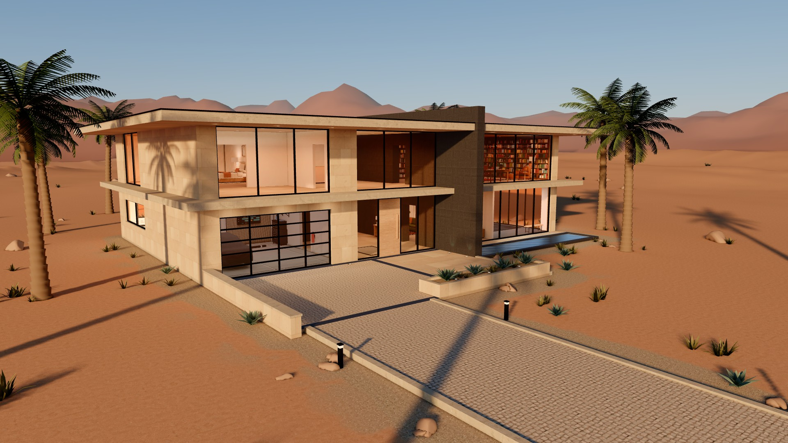

# Villa portfolio

My portfolio as a modern house in the desert at golden hour, which you can walk
around in your browser. Each room holds one part of my work: a chess coach on the
dining table, VAREK Systems on the study's whiteboard, a CS2 Pick'Em optimizer
on the games room's screens, books, trophies, music, and a resume behind a little
door under the stairs. Get in touch from the lounger by the pool.

**Visit it: https://zvezda4994.github.io/villa-portfolio/** (works on a laptop or a
phone; drag to look around, or pick a room from the Rooms menu).



It's built entirely from Python scripts in Blender, with the lighting worked out
ahead of time, and shown with three.js. Version 1 is done; `PROGRESS.md` has the
decisions, the traps found along the way and what comes later, and `BUILD_BRIEF.md`
is the plan it followed.

## Look at it

```
python tools/serve.py
```

Then open http://localhost:5173. There is no build step for the site: the files
in `web/` are exactly what gets served.

The live site is https://zvezda4994.github.io/villa-portfolio/. Every push to
`main` runs the tests (`npm test`) and, if they pass, publishes `web/` to
GitHub Pages (`.github/workflows/pages.yml`).

## What is where

| Folder | What it holds |
|---|---|
| `web/` | The site. `index.html`, `styles.css`, and the code in `src/`. |
| `web/src/rooms.js` | **All the text** visitors read: one entry per room, plus the resume. Edit this to change copy. |
| `web/src/main.js` | Camera, the three views, labels, side panel, rooms menu, links. Carried over from the prototype. |
| `web/src/world.js` | Loads the model and decides how each material is drawn. Fetches furnished rooms after the first view. |
| `web/assets/` | What Blender exported: the model, textures, lightmaps, sky. Rebuilt by the scripts, not edited by hand. |
| `web/assets/rooms/` | One file per furnished room (`dining.glb`, `pool.glb`), loaded in the background. |
| `blender/` | Python scripts that build the whole scene in Blender from nothing. |
| `blender/villa/` | The scene itself, split by subject: `house.py`, `exterior.py`, `terrain.py`, `plants.py`, `lighting.py`, `materials.py`. Sizes, the sun position and the chess position are in `config.py`. |
| `blender/villa/dining.py` | The dining room's furniture, lamps and cameras. The template for furnishing the other rooms. |
| `blender/villa/props.py` | Brings in the downloaded Poly Haven models and places copies of them. |
| `blender/villa/pool.py` | The pool deck: loungers, towels, parasol, fire-pit lounge, planters and trees, lanterns, the table setting, and the camera moment. |
| `blender/villa/frozen/` | The visitor's hand and a loafer, kept as plain meshes (see `PROGRESS.md`, "The pool deck"). |
| `blender/villa/study.py` | The study (VAREK): whiteboard, sofa, desk, bookshelf, the Persian rug, its lamps and cameras. |
| `blender/villa/games.py` | The games room (CS2): the black and white setup, the screens, PC, panels, print and sofa. |
| `blender/villa/kit.py` | Building blocks the newer rooms share: boxes, shaped cushions, tubes, swept arms, grids. |
| `blender/villa/labels.py` | Prints lettering into pictures: the contact card, the sake label, screens and spines (Inter), the whiteboard and journal (Kalam). |
| `previews/` | Review pictures for each build step. |
| `tools/` | Small helpers: a runner for the Blender scripts and the local preview server. |
| `tests/` | Checks run before every deploy: the exported files load, the downloads fit the budget, the rooms data is complete. |
| `build/`, `assets_src/` | Scratch output, and the downloaded textures and models. Not committed. |

## Rebuilding the 3D scene

You only need this if you change something in `blender/`.

Needs: Blender (written and tested against 5.3), Python 3, and Node for the
`npm run` shortcuts. If Blender is not in a standard place, set the `BLENDER`
environment variable to the full path of `blender.exe`.

```
npm run assets     # once: download the source textures and models (about 35 MB, all CC0)
npm run scene      # build the scene            -> build/villa.blend           (seconds)
npm run bake       # work out the lighting      -> web/assets/lightmaps        (minutes, uses the GPU)
npm run export     # write the model, textures, sky -> web/assets              (about a minute)
npm run previews   # render the review pictures -> previews/
npm run figure     # add, update or remove the dining room figure only     (seconds)
npm run stills     # the pictures shown while the 3D loads, and the link preview -> web/assets/stills, web/og.jpg
npm run loadtime   # time a cold load on throttled "Fast 4G" (add a URL to time another copy, --phone for a phone)
```

`npm run build` does scene, bake and export in one go. While experimenting,
`npm run bake:draft` and `npm run previews:draft` are fast, rough versions.
Run `npm run stills` after anything that changes how the house looks (a bake, an
export): the stills are drawn by the site itself in headless Chrome, so they match
the 3D that fades in over them.

The scene is never edited by hand in Blender. Open `build/villa.blend` to look
around, but make changes in the scripts and rebuild, so the scene can always be
recreated.

## How the lighting works

The browser does not calculate any lighting. Blender (Cycles) works out how much
light lands on every surface once, at golden hour, and saves the answer:

- Big flat surfaces (walls, floors, paving, sand) get **lightmaps**: textures that
  store light instead of colour. There are four, each 2048 px: outside surfaces,
  ground floor, upstairs, and the sand.
- Small bumpy things (palms, shrubs, rocks, hills, window frames) store their
  light **per vertex**, which needs no texture at all.

In the browser each surface is its tiling colour texture multiplied by its baked
light, plus a reflection of the sky. That is why it runs on a laptop or phone.

Furnished rooms work the same way, with two additions:

- Each furnished room has its own lightmap for its big flat furniture (the
  dining room's is `din`: table, rug, painting, chessboard, planters).
- Downloaded models (chess pieces, sideboard, plants...) keep their own colour
  picture, multiplied by light baked into their vertices.

The sun position is fixed in `blender/villa/config.py`. Moving it means running
the bake again.

Each lightmap is saved twice: a small 512 px copy that loads straight away, and
the sharp full-size one that replaces it a moment later.

Cycles can't denoise a bake, so the bake script smooths the leftover grain itself
(`blender/villa/denoise.py`), only within each surface and never across a sharp edge
like a sun patch or a shadow.

Reflections come from panoramas Blender renders at export time: one of the sky
and desert for glass and paving, and one taken from just above the pool for the
water (from there the house hides the bright sky around the sun, so the water
reflects the house instead). The sky files are written by `blender/villa/hdr.py`
rather than Blender's own .hdr saving, which in Blender 5.3 changes the values on
the way out and made the browser's sky look washed out.

## Download size

About 7.7 MB loads before the landing view appears (model, colour textures, the
small lightmaps, sky and water reflections): on a "Fast 4G" connection the
picture of the house shows in under a second and the 3D takes over at about
10 seconds, on a desktop or a phone. The sharp lightmaps (about 12 MB) follow in
the background, and each room loads on its own: between 0.5 and 4.4 MB, a few
seconds once the house is up. Everything together is about 50 MB.

The brief's targets: the landing view interactive in about 10 MB, and each room's
own download around 4 MB. The tests fail if the landing view needs more than 11 MB,
or a room more than 4.5 MB. `npm run loadtime` measures a cold load;
`web/assets/manifest.json` lists every file after each export.

## Review pictures

`previews/landing.jpg`, `pool.jpg`, `entrance.jpg`, `dining.jpg` (the dining
room), `chess.jpg` (the board, from the visitor's seat), `deck.jpg` (the pool
deck) and `pool_moment.jpg` (the visitor's view from their lounger) are
rendered by Blender. The `browser_*.jpg` files next to them are the real site
from the same camera positions, so the two can be compared.

To see those camera positions in the site, add `?shot=landing&ui=0` to the
address (or `pool`, `entrance`, `dining`, `chess`, `deck`, `pool_moment`). Adding `&save=landing` as
well, while `tools/serve.py` is running, saves the browser picture into
`previews/` once the furnished rooms have loaded.

Where the two still differ, on purpose or for now:

- The far hills are a little hazier in the browser. That haze is added on
  purpose for depth; Blender's render has none.
- Window glass in the browser reflects the open sky even where, in reality, the
  roof overhang would be reflected. From low angles the upstairs rooms look a
  touch paler through the glass than in Blender.
- Sand facing straight into the sun lacks the faint sheen Cycles gives it.

## Layout notes

The room positions follow the prototype. Three things were decided along the way:

- **Upstairs** is now a full floor, as the brief asks. Back row: main bedroom,
  games room, trophy room (opening onto the terrace over the pool). Front row:
  a lounge off the bedroom, the stair landing, and the library.
- **The dark stone wall** between the foyer and the study carries on out through
  the front of the house and up past the roof. It is the one tall element
  against all the long flat lines.
- **The doorway from the foyer to the dining room** moved to the right-hand end
  of that wall, because the stairs run along the rest of it.

Space for the later "vault" room: a lower level reached from the foyer, beside
the stairs. Nothing is built there yet and nothing blocks it.

The dining room (all in `blender/villa/dining.py`):

- A 3 m walnut table on two dark stone legs, with eight leather and walnut
  chairs on a wool rug. The table, sideboard and painting share one centre line.
- A pair of wide bronze pendants hang 80 cm over the table.
- A long walnut sideboard against the foyer wall holds a bronze horse's head and
  two white vases. An original abstract painting of the desert at dusk hangs above it.
- A fig tree and a philodendron stand in dark stone planters by the pool glass.
- A game is in progress at the living-room end of the table. The visitor's seat
  faces the glass. The chair across is pushed back and turned, as if the
  opponent has just stood up. Opening the dining room drops the camera into that
  seat, looking down over the board.
- The living room stays open to it and is still empty.
- The chair across the board can hold a figure you supply (`FIGURE` in
  `config.py`). It goes in and comes out with `npm run figure`, without a
  re-bake. See `PROGRESS.md` for the steps.

The pool deck (all in `blender/villa/pool.py`), widened 2 m to the south:

- At the pool's sunny south-west corner, two long teak loungers side by side,
  a step back from the water and facing it, each turned 12° in toward the
  other, with a low travertine side table between them.
- Behind them, a cream canvas cantilever parasol holds its canopy over their
  head ends: eight panels tensioned over the ribs, with seams, a rolled hem and
  a capped peak. The sun is so low that its shadow falls about 9 m behind, off the
  deck, so the loungers and the table stay in the sun.
- The visitor's has a folded towel at its foot. Mine is set as if I'd just
  stepped away: a navy towel left spread over it, my sunglasses, an isshobin
  (the tall 1.8 litre sake bottle) with an original label and a small stoneware
  cup on the table, my loafers slipped off beside the head of my lounger.
- My contact card stands on the table, folded, turned and tilted toward the
  visitor (placeholder text for now, from `CONTACT_CARD` in `config.py`).
  Clicking or tapping it opens the "Get in touch" panel.
- On the south side, in the house's evening shade, low sofas round a dark
  stone fire pit on an outdoor rug.
- Four quiver trees (Poly Haven) and two palms in big pale stone planters,
  each with an uplight; five lanterns; the pool keeps its own lights.
- The walkway along the house is left open.
- Opening the pool drops the camera onto the visitor's lounger at eye level,
  looking out over the pool to the house, with my lounger and the table in the
  left third. The visitor's own hand holds a martini at the bottom of the
  frame; it travels with the camera while you stay near that seat.

The forecourt, as reworked after step 1 (all in `blender/villa/exterior.py`):

- A smaller court of warm granite setts in front of the garage, framed by bands
  of the same dark granite as the stone wall, and large pale slabs leading to the
  front door. The car will be parked on the setts.
- A low stone wall continues the line of the house's west wall out to the drive.
  A long planter of agaves and grasses closes the front of the entrance.
- A shallow reflecting pool runs in front of the study and gym, with the dark
  stone wall rising out of its end.
- Uplights in the paving wash the stone piers and the dark wall; step lights sit
  in the low wall; the drive keeps its bollards.
- Every paved edge ends in a kerb, wall, planter or coping, with a gravel border
  (`terrain.build_mask`) and rocks, shrubs and agaves along it.
- The drive is pale granite setts with raised kerbs.
- Sheer curtains hang inside the upstairs glass until those rooms are furnished.

## Later

Version 1 is done (22 Nov 2026). Planned for later:

- The car in the forecourt (a licensed model, headlights and an engine start on click).
- The Meruem figure at the dining table, across the board from the visitor.
- My character on the pool deck, from a proper base mesh.
- A form on the library desk for leaving me a message.

Assets and their licenses are listed in `CREDITS.md`.
